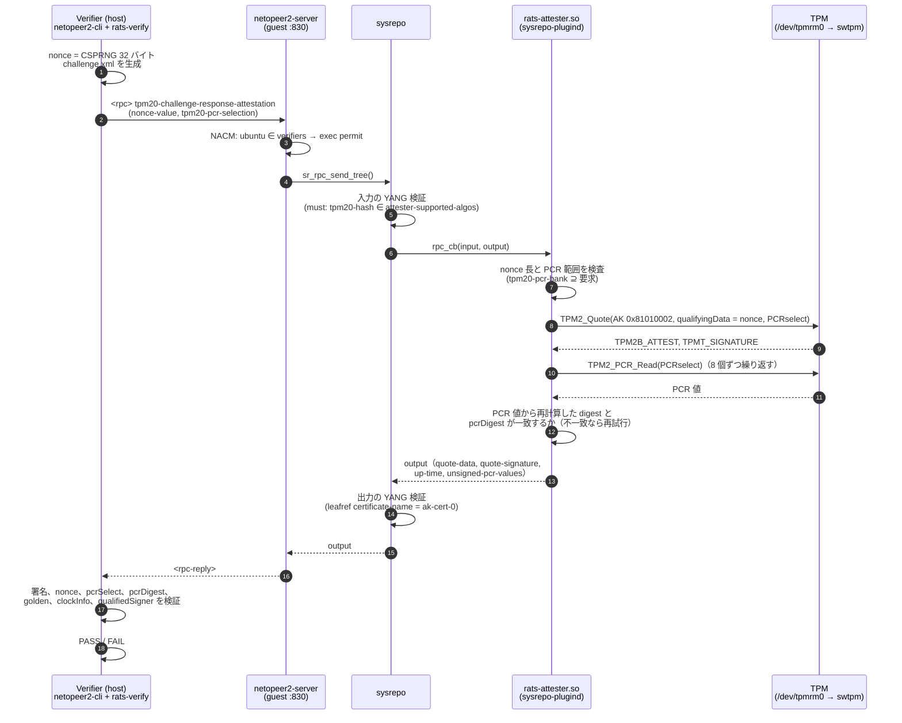

# ⑤ Challenge-Response Remote Attestation（tpm20-challenge-response-attestation）

[README](README.md) の手順 ⑤ の詳細。次の 3 つを設計する。

- Attester 側（guest）: AK の準備と、RPC を処理する sysrepo-plugind の plugin `rats-attester.so`
- メッセージの形
- Verifier 側（host）: 検証の手順

実装はリポジトリの `attester/`（guest）と `verifier/`（host）にある（[README](README.md) §9。進み具合は README の冒頭）。

## 1. 全体の流れ



## 2. AK の準備（guest、ubuntu ユーザー、1 回だけ）

### 2.1 鍵の構成

| 鍵 | 階層 | アルゴリズム | 属性 | 永続ハンドル |
|---|---|---|---|---|
| EK | endorsement | RSA2048（TCG の既定テンプレート） | 既定 | `0x81010001` |
| AK | endorsement（EK の子） | ECC NIST P-256、ECDSA、SHA-256 | `fixedtpm\|fixedparent\|sensitivedataorigin\|userwithauth\|restricted\|sign`（tpm2_createak の既定） | `0x81010002` |

AK を EK の子（endorsement 階層）にする理由:

- TPM は、署名する鍵が endorsement 階層にも platform 階層にも属さない場合、TPMS_ATTEST の `resetCount`、`restartCount`、`firmwareVersion` を難読化する。
  旧方式の AK は owner 階層のプライマリの子だったので、難読化されていた。
  EK の子にすると、これらの値をそのまま読めるので、Verifier で再起動を検出できる（§5.2 の検査 7）。
- RFC 9683 の LAK に近い構成になり、将来 credential activation を追加しやすい（[06](06_future_extensions.md) §2）。

### 2.2 `provision_ak.sh`

`attester/provision_ak.sh`。cmake の構成時（`cmake ..`。§3.8）に **build ディレクトリの直下**（`build/provision_ak.sh`）にコピーされる
（`configure_file`。元のファイルを変えると、次の `make` でコピーし直される）。システムには入れない。**sudo を付けずに** `ubuntu` ユーザーで実行し、公開情報を `build/keys/` に書き出す。何度実行しても同じ状態になる。

```bash
# guest（ubuntu ユーザー）
cd ~/tpm-remote-attestation-netopeer2/build
./provision_ak.sh                 # 出力先を変えるときは ./provision_ak.sh <OUT_DIR>
```

sudo が要らない理由と前提:

- TPM には `/dev/tpmrm0` を通して触る。Ubuntu の udev 規則（`/usr/lib/udev/rules.d/60-tpm-udev.rules`）では `/dev/tpmrm0` は `tss:tss 0660` なので、
  `tss` グループのユーザーなら root でなくてよい。guest の `ubuntu` は `tss` グループに入っている（2026-10-14 に `id` で確認）。
  入っていなければ、スクリプトは `sudo usermod -aG tss ubuntu` を案内して終了する（入れたあとは再ログインが要る）。
- `/dev/tpm0` は `tss:root 0660` で、`ubuntu` からは開けない。tpm2-tools は TCTI を指定しないと既定の探索順で選ぶので、
  スクリプトは `TPM2TOOLS_TCTI=device:/dev/tpmrm0` に固定する（plugin の `tcti` と同じ）。
- EK と AK の作成、永続化（`tpm2_evictcontrol -C o`）に要る owner 階層と endorsement 階層の認可値は空なので、OS の権限は要らない。

スクリプトが行うこと（全文は `attester/provision_ak.sh`）:

```bash
export TPM2TOOLS_TCTI=${TPM2TOOLS_TCTI:-device:/dev/tpmrm0}
handles=$(tpm2_getcap handles-persistent)

# 永続ハンドルが無いときだけ作る。ak.ctx などの途中のファイルは一時ディレクトリに置いて捨てる
tpm2_createek -c 0x81010001 -G rsa -u "$TMP/ek.pub"
tpm2_createak -C 0x81010001 -c "$TMP/ak.ctx" -G ecc -g sha256 -s ecdsa -u "$TMP/ak.pub" -n "$TMP/ak.name"
tpm2_evictcontrol -C o -c "$TMP/ak.ctx" 0x81010002

# 鍵が前からあった場合も同じファイルがそろうよう、公開情報は毎回 TPM から読み直して書き出す
tpm2_readpublic -c 0x81010001 -f tss -o keys/ek.pub -n keys/ek.name
tpm2_readpublic -c 0x81010001 -f pem -o keys/ek.pem
tpm2_readpublic -c 0x81010002 -f tss -o keys/ak.pub
tpm2_readpublic -c 0x81010002 -f pem -o keys/ak-cert-0.pem -n keys/ak-cert-0.name -q keys/ak-cert-0.qname
```

`build/keys/` に書き出すもの:

| ファイル | 内容 | 使い道 |
|---|---|---|
| `ek.pub` | EK の公開部分（TPM2B_PUBLIC。tpm2-tools の tss 形式） | credential activation（[06](06_future_extensions.md) §2） |
| `ek.pem` | EK の公開鍵（SubjectPublicKeyInfo の PEM） | 同上 |
| `ek.name` | EK の name | 同上 |
| `ak.pub` | AK の公開部分（TPM2B_PUBLIC） | `tpm2_makecredential` など |
| `ak-cert-0.pem` | AK の公開鍵（SubjectPublicKeyInfo の PEM） | Verifier に登録する（§2.3）。署名検証（§5.2 の検査 1） |
| `ak-cert-0.name` | AK の name | Verifier に登録する。plugin の起動時のログと照合する |
| `ak-cert-0.qname` | AK の qualified name | Verifier に登録する。TPMS_ATTEST の `qualifiedSigner` と比べる（§5.2 の検査 8） |

- 鍵の本体（秘密鍵）は TPM の中にあり、外には出ない。書き出すのは公開部分と name だけ。
- `ak-cert-0.pem` は X.509 証明書ではない。ファイル名は certificate-name（`ak-cert-0`）に合わせた。
- `build/` は git の管理外（`.gitignore`）なので、`build/keys/` も commit されない。`build/` を消すと公開情報も消えるが、
  鍵は TPM の永続ハンドルに残っているので、`./provision_ak.sh` を実行し直せば同じ内容が書き出される。

### 2.3 Verifier への登録（enrollment）

```bash
# host
cd ~/github/tpm-remote-attestation-netopeer2/build/verifier/enroll
for f in ak-cert-0.pem ak-cert-0.name ak-cert-0.qname; do
    ssh -p 2222 ubuntu@localhost "cat tpm-remote-attestation-netopeer2/build/keys/$f" > "$f"
done
sha256sum ak-cert-0.* > ENROLLED.sha256      # 登録した日時と一緒に記録しておく
```

- 登録先の `enroll/` は、Verifier の作業ディレクトリ `build/verifier/`（§5.1）の中にあり、cmake の構成時に作られる。
  `build/` を消すと登録も消えるので、作り直す前に控えを取る（§5.1）。
- 登録は、既存の SSH（管理者の資格情報で認証された経路）を使い、既知の正常状態のときに行う。
  NETCONF の応答から AK を取り込むこと（TOFU）はしない。
- 「この AK が本当にこの TPM の中にある」ことを暗号的に示すには credential activation が必要になる。
  今回は範囲外とし、[06](06_future_extensions.md) §2 で扱う。

### 2.4 swtpm の状態が消えるリスク

`bin/tpm_emulator.sh` は、swtpm の状態（NVRAM）を `/tmp/emulated_tpm` に置いている。
WSL を再起動して `/tmp` が消えると、EK と AK も消える。

- 影響: AK が変わる。Verifier の署名検証が失敗し（テスト E-15）、登録し直す必要がある。
- 対策案（実装時に判断する）: `tpm_emulator.sh` の `--tpmstate dir=` を、`${TPM_STATE_DIR:-$HOME/swtpm/state}` のような永続的なディレクトリにする。
  ソケットは今までどおり `/tmp/emulated_tpm/swtpm-sock` に置いてよい（QEMU スクリプトはそのパスを参照している）。
- swtpm を起動し直しても PCR はリセットされる（電源の入れ直しに相当）。QEMU を起動するたびに measured boot がやり直されるのは想定どおり。
- **2026-10-14 に実際に起きた。** WSL の再起動（12:45 JST）で `/tmp/emulated_tpm` が消え、swtpm が空の状態で起動した。
  その前に作った EK と AK が無くなり、sysrepo-plugind で `rats-attester` の初期化が
  `AK 0x81010002 not available (Esys_TR_FromTPMPublic): tpm:handle(1):the handle is not correct for the use`（`TPM_RC_HANDLE`）で失敗した。
  見分け方: `tpm2_getcap handles-persistent` が空になり、`tpm2_readclock` の `clock` が swtpm の起動からの経過時間と一致する（clock は状態ファイルに保存されて引き継がれる値なので、新品の TPM になったことが分かる）。
  このときは状態の永続化はせず、`provision_ak.sh` で EK と AK を作り直し、§2.3 の登録をやり直して対処した。永続化は未実施。

### 2.5 Reference Value（golden）

既知の正常状態で 1 回 attestation を行い、§5.2 の検査 1〜5 がすべて通った応答の `unsigned-pcr-values` を golden として保存する。
これは「保存した時点の状態を信頼する」という前提に立っている。この前提は README と結果の記録に明記する。
event log を replay して期待値を作る方法は [06](06_future_extensions.md) §1 で扱う。

`build/verifier/ref-values/pcrs-sha256.json`（作業ディレクトリは §5.1）:

```json
{
  "certificate-name": "ak-cert-0",
  "hash": "sha256",
  "captured": "2026-10-05T00:00:00+09:00",
  "note": "u-boot_measuredboot.elf + ubuntu-24.04.4-preinstalled-server-riscv64.img",
  "pcrs": {
    "0": "<64 桁の hex>",
    "1": "<64 桁の hex>",
    "7": "<64 桁の hex>"
  }
}
```

`rats-verify`（§5.2）はこのファイルを次のように読む。

| キー | 扱い |
|---|---|
| `hash` | 必須。`sha1`、`sha256`、`sha384`、`sha512` のどれか。この bank の PCR だけを照合する |
| `pcrs` | 必須。PCR 番号（10 進の文字列）→ 値（hex）。値の長さは `hash` のダイジェスト長 |
| `certificate-name` | 任意。あれば応答の `certificate-name` と一致しなければならない |
| `captured`、`note` | 記録用。検査には使わない |

- golden に入れた PCR は、検査 4 で「quote に含まれていなければならない PCR」になる（Verifier が期待する selection は golden で決まる。§5.2）。
- golden に入れていない PCR は、quote に含まれていても検査 6 で「未評価」になる。
  例えば PCR 9 の変化（§6.2 の E-5）を検出するには、PCR 0〜10 を要求した応答から golden を作る。

作り方（host、作業ディレクトリ `build/verifier/` で）。`rats-verify` の結果の `pcrs.<hash>` が、そのまま `pcrs` の形になっている。
検査 1〜5 と 8 が ok であることを確かめてから保存する（golden が無いので、結果そのものは INCOMPLETE になる）。

```bash
../rats-verify --reply out/reply.xml --nonce out/nonce.bin \
    --ak enroll/ak-cert-0.pem --ak-qname enroll/ak-cert-0.qname > out/result.json
jq -e '[.checks.signature, .checks.magic_type, .checks.nonce, .checks.pcr_select, .checks.pcr_digest,
        .checks.qualified_signer] | all(startswith("ok"))' out/result.json      # true でなければ保存しない
jq --arg note "u-boot_measuredboot.elf + ubuntu-24.04.4-preinstalled-server-riscv64.img" \
   '{"certificate-name": .["certificate-name"], hash: "sha256", captured: (now | todate), note: $note, pcrs: .pcrs.sha256}' \
   out/result.json > ref-values/pcrs-sha256.json
```

## 3. Attester: `rats-attester.so`（sysrepo-plugind の plugin）

### 3.1 役割と動き方

- sysrepo-plugind は起動時に、plugin ディレクトリ（`/usr/local/lib/sysrepo-plugind/plugins/`。環境変数 `SRPD_PLUGINS_PATH` で変えられる）にある `.so` を `dlopen` し、
  `sr_plugin_init_cb()` を呼ぶ。終了時には `sr_plugin_cleanup_cb()` を呼ぶ（`sysrepo/src/executables/sysrepo-plugind.c`）。
  plugin 名はファイル名から拡張子を除いたもの（`rats-attester`）。
- `rats-attester.so` は init で次を購読する。
  - RPC `/ietf-tpm-remote-attestation:tpm20-challenge-response-attestation`: TPM2_Quote を実行して出力を返す（§3.5）
  - `/ietf-tpm-remote-attestation:rats-support-structures/tpms/tpm` の状態データ（config false）（§3.7）
  - RPC `tpm12-challenge-response-attestation` と `log-retrieval`: `operation-not-supported` を返す（§3.6）。
    スキーマに RPC のノードが無いときは購読しない。`tpm12-challenge-response-attestation` には `if-feature "taa:tpm12"` があり、
    feature `tpm12` を有効にしていないので、今の構成では購読されない
- sysrepo-plugind は systemd で root として常駐する（`sysrepo-plugind.service`。[02](02_netopeer2_systemd.md) §1.3、§3）。
  plugin 自身は unit、`main()`、シグナル処理を持たない。TPM との起動順は、sysrepo-plugind の unit に drop-in で付ける。
- ログは `SRPLG_LOG_ERR/WRN/INF/DBG("rats-attester", ...)` で出す。unit の `-d` により stderr に出て、journald に入る（`journalctl -u sysrepo-plugind`）。
  unit の既定の `-v2` では WRN 以上しか出ないので、監査ログや所要時間（INF）を見るときは `-v3` にする（[02](02_netopeer2_systemd.md) §4.1）。
- 依存ライブラリ: `libsysrepo`、`libyang`、`libtss2-esys`、`libtss2-mu`、`libtss2-tctildr`、`libtss2-rc`、`libcrypto`（OpenSSL。pcrDigest の再計算と base64。tpm2-tss 自身の依存でもある）、pthread。

### 3.2 ソースの構成（`attester/`）

| ファイル | 内容 |
|---|---|
| `src/plugin.c` | `sr_plugin_init_cb()`（§3.4 の 1〜8）と `sr_plugin_cleanup_cb()`（§3.4 の 9）。共通の補助関数: `rats_nc_error()`（§3.6）、`rats_schema_has_node()`、`rats_load_pcr_banks()`（running の `tpm20-pcr-bank` と certificate の読み出し。§3.4 の 7 と §3.5 の 1 で使う）、identity と `TPM2_ALG_ID` の相互変換 |
| `src/attester.h` | 共有する `struct rats_attester`（設定、TPM、`tpm_lock`、購読 `sub`）、XPath の定数、各ファイルの購読関数の宣言 |
| `src/conf.c` / `conf.h` | 設定ファイル（§3.3）の解析 |
| `src/tpm.c` / `tpm.h` | ESAPI のラッパー: 初期化、AK の読み込み、Quote、PCR_Read（8 個ずつ繰り返す）、GetCapability、GetTestResult |
| `src/tpm20-challenge-response-attestation.c` | RPC のコールバック（§3.5）と `rats_tpm20_cra_subscribe()` |
| `src/rats-support-structures.c` | 状態データのコールバック（§3.7）と `rats_support_structures_subscribe()` |
| `src/tpm12-challenge-response-attestation.c` | `operation-not-supported` を返す（TPM 1.2 は対象外。[06](06_future_extensions.md) §6） |
| `src/log-retrieval.c` | `operation-not-supported` を返す（実装は [06](06_future_extensions.md) §1） |
| `rats-attester.conf` | 設定ファイル（§3.3） |
| `provision_ak.sh` | AK の準備（§2.2）。cmake の構成時に `build/` にコピーされ、sudo なしで実行する |
| `systemd/sysrepo-plugind.service.d/10-rats-attester.conf` | sysrepo-plugind の unit の drop-in（[02](02_netopeer2_systemd.md) §3） |
| `scripts/install_yang.sh`、`scripts/install_config.sh` | YANG、初期設定、NACM の導入（[04](04_rfc9684_yang.md) §4、§5、§7.3） |
| `CMakeLists.txt` | ビルドとインストール（§3.8） |

### 3.3 設定ファイル `/etc/rats-attester.conf`

```ini
# rats-attester（sysrepo-plugind の plugin）の設定
tcti             = device:/dev/tpmrm0
tpm-name         = tpm0
certificate-name = ak-cert-0
ak-handle        = 0x81010002
hardware-based   = false          # swtpm なので false
nonce-min        = 16             # バイト
nonce-max        = 64             # バイト（TPM2B_DATA に収まる上限）
quote-retry      = 3              # Quote と PCR_Read の間に PCR が変わったときの再試行回数
```

- 形式は `key = value`。`#` 以降はコメント。未知の key と、値の形式の誤り（`ak-handle` が 16 進数でない、`nonce-max` が 64 を超えるなど）はエラーにする。
- AK のハンドルは YANG モデルに無いので、certificate-name との対応をこのファイルで持つ。
  将来 `mtpm` を使うときは、`[certificate]` のセクションを複数持てる形式に広げる（[06](06_future_extensions.md) §4）。
- パスの既定値はビルド時に決まる（CMake のキャッシュ変数 `RATS_ATTESTER_CONF`。既定は `/etc/rats-attester.conf`）。
  実行時は環境変数 `RATS_ATTESTER_CONF` で上書きできる（sysrepo-plugind の unit の drop-in に `Environment=` で書く）。
- `make install` で、リポジトリの `attester/rats-attester.conf` が `/etc/` に入る。guest で直接編集した内容は上書きされうるので、値を変えるときはリポジトリのファイルを直す。

### 3.4 初期化と後始末

sysrepo-plugind は、`sr_connect()` と `sr_session_start(conn, SR_DS_RUNNING, &sess)` を済ませてから、そのセッションを `sr_plugin_init_cb(session, &private_data)` に渡す。
すべての plugin が同じ接続とセッションを使う。

`sr_plugin_init_cb()` の処理:(plugin.c)

1. 設定ファイルを読む（`rats_conf_load()`）。
2. `Tss2_TctiLdr_Initialize(conf.tcti, &tcti)` → `Esys_Initialize(&esys, tcti, NULL)`。
3. `Esys_TR_FromTPMPublic(esys, conf.ak_handle, ESYS_TR_NONE, ESYS_TR_NONE, ESYS_TR_NONE, &ak)`。
4. `Esys_ReadPublic(esys, ak, ...)` で AK の公開部分、name、qualified name を取得する。
   - 属性に `restricted`、`sign`、`fixedTPM` があること、方式が ECDSA/SHA-256 であることを確かめる。
   - name を hex で INF のログに出す。運用者が登録済みの値と照合できるようにする。
5. `Esys_GetCapability` で次を取得する。
   - `TPM2_CAP_TPM_PROPERTIES` の `TPM2_PT_FAMILY_INDICATOR`: "2.0" であること
   - `TPM2_PT_MANUFACTURER`: 状態データに使う
   - `TPM2_PT_PCR_COUNT`: PCR 番号の上限
   - `TPM2_CAP_PCRS`: 有効な bank
6. sysrepo には自分で接続しない。初期化では引数の `session`（running）を使う。
   コールバック用には、同じ接続（`sr_session_get_connection(session)`）から running のセッションを 1 つ作って持つ（`app->run_sess`）。
   RPC のコールバックに渡される implicit session は **operational** なので（`sysrepo/src/shm_sub.c` の
   `_sr_session_start(conn, SR_DS_OPERATIONAL, SR_SUB_EV_RPC, ...)`）、それで running を読むことはできない。
   コールバックは 1 スレッドで直列に動くので、セッションを共有してよい。
7. `rats_load_pcr_banks()` が `sr_get_data(session, ".../tpms/tpm[name='tpm0']", ...)` で設定を読み、確かめる。
   - `tpm[name='tpm0']` と、その下に `certificate[name='ak-cert-0']` があること
   - `tpm20-pcr-bank` が 1 つ以上あり、どの bank も TPM で有効（`TPM2_CAP_PCRS` で PCR が割り当てられている）であること
   - 設定に TPM の PCR 数以上の番号があれば、警告だけ出す（その PCR を要求されたときに `invalid-value` になる。テスト E-8）
8. 購読する。**すべて同じ `sr_subscription_ctx_t *`（`app->sub`）に登録し**、コールバックを 1 つのスレッドで直列に処理させる（ESYS_CONTEXT はスレッドセーフではない）。
   念のため、TPM を呼ぶ部分は `app->tpm_lock`（mutex）でも保護する。購読は、各ソースファイルの `rats_*_subscribe()` が行う。

   ```c
   sr_rpc_subscribe_tree(session, RATS_XPATH_TPM20_RPC, rpc_cb, app, 0, 0, &app->sub);
   sr_oper_get_subscribe(session, RATS_MOD_NAME, RATS_XPATH_TPM_OPER, oper_cb, app, SR_SUBSCR_OPER_MERGE, &app->sub);   /* §3.7 */
   /* tpm12 と log-retrieval は、rats_schema_has_node() でスキーマに RPC のノードがあるときだけ購読する */
   sr_rpc_subscribe_tree(session, RATS_XPATH_TPM12_RPC, tpm12_cb, app, 0, 0, &app->sub);
   sr_rpc_subscribe_tree(session, RATS_XPATH_LOG_RPC, log_cb, app, 0, 0, &app->sub);
   /* モジュールの「所有者」になるためだけの購読。change_cb は何もしない */
   sr_module_change_subscribe(session, RATS_MOD_NAME, NULL, change_cb, app, 0, SR_SUBSCR_DONE_ONLY, &app->sub);
   ```

   最後の `sr_module_change_subscribe` は、設定を処理するためではない。sysrepo は、変更を（`SR_SUBSCR_PASSIVE` 無しで）購読している
   プロセスがいる間だけ、そのモジュールの running の設定を operational に入れる（`sysrepo/src/sysrepo_types.h:386-388`）。
   これにより、`rats-attester.so` が動いている間は operational に設定と §3.7 の状態データが並び、`sysrepocfg -X -d operational` や
   NETCONF の `get` で一緒に見える（[04](04_rfc9684_yang.md) §8）。設定の変更そのものは、RPC のたびに running から読み直す（§3.5 の 1）。

   最後に `*private_data = app` として `SR_ERR_OK` を返す。

`sr_plugin_cleanup_cb(session, private_data)` の処理:

9. `sr_unsubscribe(app->sub)` → `sr_session_stop(app->run_sess)` → `Esys_Finalize` → `Tss2_TctiLdr_Finalize` → 設定の解放の順に後始末する。
   接続と引数のセッションは sysrepo-plugind のものなので、`sr_disconnect` はしない。

初期化に失敗したとき（1〜8 のどこかで失敗したとき）:

- ERR のログに理由を出し、それまでに確保したもの（TPM のコンテキスト、作った購読）を init の中で解放してから、エラーの `sr_error_t` を返す。
  失敗した plugin の `sr_plugin_cleanup_cb()` は呼ばれないため。
- sysrepo-plugind は `Plugin "rats-attester" initialization failed` をログに出し、その plugin を外したまま動き続ける（`-f` を付けたときだけ終了する）。
  この状態では RPC の購読者がいないので、RPC は `operation-failed` になる（テスト E-13 と同じ）。原因を直してから `sudo systemctl restart sysrepo-plugind` を実行する。

### 3.5 RPC コールバック

`src/tpm20-challenge-response-attestation.c`:

```c
static int rpc_cb(sr_session_ctx_t *session, uint32_t sub_id, const char *op_path,
                  const struct lyd_node *input, sr_event_t event, uint32_t operation_id,
                  struct lyd_node *output, void *private_data);   /* private_data は struct rats_attester * */
```

型は sysrepo の `sr_rpc_tree_cb`（`sysrepo/src/sysrepo_types.h:594`）。`input` と `output` は RPC の要素自身（`tpm20-challenge-response-attestation`）。

処理の手順:

0. **監査ログ**: `sr_session_get_orig_name(session)`（netopeer2 からなら `"netopeer2"`）と、
   `sr_session_get_orig_data(session, 0/1, ...)`（NETCONF のセッション ID とユーザー名）を INF のログに出す。
1. **設定を読む**: RPC のたびに running の `tpm20-pcr-bank` を読み直す（`rats_load_pcr_banks()` を `app->run_sess` に対して呼ぶ。
   certificate-name の参照先があることも同時に確かめる）。古い設定を使わないため。失敗したら `operation-failed`。
2. **nonce**: `lyd_find_path(input, "tpm20-attestation-challenge/nonce-value", 0, &n)` で取り出す。
   - 生のバイト列は `LYD_VALUE_GET(&((struct lyd_node_term *)n)->value, bin)` の `bin->data` と `bin->size` で得る（libyang が base64 をデコード済み）。
   - 長さが `nonce-min` 以上、`nonce-max` 以下でなければ `invalid-value` を返す。
   - RFC には「長すぎる nonce は TPM が切り詰める」とある。しかし本設計では、Verifier が extraData と照合できなくなるので、切り詰めずに拒否する。
3. **PCR selection**: `lyd_find_xpath(input, "tpm20-attestation-challenge/tpm20-pcr-selection", &set)` で取り出す。
   - 各エントリの `tpm20-hash-algo`（`lyd_get_value()` は `"ietf-tcg-algs:TPM_ALG_SHA256"` を返す）を TPM2_ALG に変換する。
     省略されていれば `TPM_ALG_SHA256` として扱う（[04](04_rfc9684_yang.md) §6 の 6）。

     | identity | TPM2_ALG_ID |
     |---|---|
     | `TPM_ALG_SHA1` | `0x0004` |
     | `TPM_ALG_SHA256` | `0x000B` |
     | `TPM_ALG_SHA384` | `0x000C` |
     | `TPM_ALG_SHA512` | `0x000D` |

   - `pcr-index` の leaf-list を `pcrSelect[]` のビットにする。`sizeofSelect` は `TPM2_PT_PCR_COUNT / 8`（通常は 3）。
   - `tpm20-pcr-selection` が 1 つも無いときは、`tpm20-pcr-bank` のすべての bank とすべての PCR を対象にする。
     エントリはあるが `pcr-index` が無いときは、その bank の設定済み PCR すべてを対象にする。
   - 同じ bank が 2 回現れたら `invalid-value`。YANG の `unique "tpm20-hash-algo"` は、`tpm20-hash-algo` を省略した（SHA-256 扱いの）項目と
     SHA-256 を明示した項目が並ぶ場合には効かないため。
4. **範囲の検査**: 要求された（bank、PCR）の組がすべて `tpm20-pcr-bank` に含まれ、かつ PCR 番号が `TPM2_PT_PCR_COUNT` 未満であること。
   どちらかに反したら `invalid-value` を返す。
5. **Quote**: 手順 5〜7 は `app->tpm_lock` を取って行う。`rats_tpm_quote()`（`src/tpm.c`）の中身は次のとおり。

   ```c
   TPM2B_DATA qd = { .size = nonce_len };            /* buffer に nonce をコピーしておく */
   TPMT_SIG_SCHEME scheme = { .scheme = TPM2_ALG_NULL };   /* AK に設定された方式（ECDSA/SHA-256）を使う */
   Esys_Quote(esys, ak, ESYS_TR_PASSWORD, ESYS_TR_NONE, ESYS_TR_NONE,
              &qd, &scheme, &pcr_sel, &quoted, &signature);
   ```

   AK の認可値は空なので、`Esys_TR_SetAuth` は不要。
6. **marshal**:
   - `Tss2_MU_TPM2B_ATTEST_Marshal(quoted, buf, sizeof(buf), &off)` → `quote-data`（先頭 2 バイトがサイズ）
   - `Tss2_MU_TPMT_SIGNATURE_Marshal(signature, ...)` → `quote-signature`
   - 返す前に、`Tss2_MU_TPMS_ATTEST_Unmarshal` で magic、type、extraData が nonce と一致することを確かめる（防御的な自己検査）。
   - 出力の binary 型の leaf は、base64 の文字列で `lyd_new_term()` に渡す（手順 9）。符号化は libcrypto の `EVP_EncodeBlock()`（改行無し）で行う。
     手順 7 の pcrDigest の再計算でも libcrypto を使うので、依存はこれ 1 つで済む。
     `lyd_new_term_raw()` でバイト列を直接渡す方法もあるが、値の検証を飛ばすので使わない。
7. **PCR 値**: `rats_tpm_pcr_read()` が `Esys_PCR_Read(esys, ESYS_TR_NONE, ESYS_TR_NONE, ESYS_TR_NONE, &remaining, &upd, &sel_out, &values)` を繰り返す。
   - 1 回で返る digest は最大 8 個。返ってきた分を `remaining` から消し、空になるまで繰り返す。
   - 読んだ値を selection の順に連結して SHA-256（AK の署名方式のハッシュ。`Esys_ReadPublic` で得た `scheme.details.ecdsa.hashAlg`）にかけ、
     TPMS_QUOTE_INFO の `pcrDigest` と比べる（libcrypto の `EVP_Digest*`。tpm2-tools の `tpm2_openssl_hash_pcr_values()` と同じ計算）。
     一致しなければ、Quote と PCR_Read の間に PCR が extend されたとみなし、手順 5 から `quote-retry` 回まで再試行する。
     それでも一致しなければ `operation-failed` を返す。
   - Quote と PCR_Read にかかった時間を ms 単位で INF のログに出す（§6.3）。
8. **up-time**: `sysinfo()` の `uptime`（uint32、秒）。
9. **出力の組み立て**（libyang 5）。キーの無い list は `lyd_new_list()` をキー無しで呼ぶ。`lyd_new_inner()` では作れない。

   ```c
   struct lyd_node *resp, *upv, *pv;
   lyd_new_list(output, NULL, "tpm20-attestation-response", LYD_NEW_VAL_OUTPUT, &resp);   /* キー無し list */
   lyd_new_term(resp, NULL, "certificate-name", app->conf.certificate_name, LYD_NEW_VAL_OUTPUT, NULL);
   lyd_new_term(resp, NULL, "quote-data",       b64_tpm2b_attest,           LYD_NEW_VAL_OUTPUT, NULL);
   lyd_new_term(resp, NULL, "quote-signature",  b64_tpmt_signature,         LYD_NEW_VAL_OUTPUT, NULL);
   lyd_new_term(resp, NULL, "up-time",          uptime_str,                 LYD_NEW_VAL_OUTPUT, NULL);
   /* bank ごとに */
   lyd_new_list(resp, NULL, "unsigned-pcr-values", LYD_NEW_VAL_OUTPUT, &upv);            /* キー無し list */
   lyd_new_term(upv, NULL, "tpm20-hash-algo", "ietf-tcg-algs:TPM_ALG_SHA256", LYD_NEW_VAL_OUTPUT, NULL);
   /* PCR ごとに */
   lyd_new_list(upv, NULL, "pcr-values", LYD_NEW_VAL_OUTPUT, &pv, "0");                  /* キー pcr-index */
   lyd_new_term(pv, NULL, "pcr-value", b64_digest, LYD_NEW_VAL_OUTPUT, NULL);
   ```

   - binary 型の値は base64 の文字列で、identityref の値は JSON 形式（`module:identity`）で渡す。
   - `lyd_new_term` は、値の形式（base64 として正しいか、identity が存在するか）をその場で検証する。
10. `SR_ERR_OK` を返す。この後 sysrepo が出力を検証する（leafref の `certificate-name` など）。

### 3.6 エラーの返し方

`rats_nc_error(session, <error-tag>, <error-path>, <message>)`（`src/plugin.c`）で NETCONF のエラーを設定してから、`sr_error_t` を返す。
中身は `sr_session_set_netconf_error(session, "application", <error-tag>, NULL, <error-path>, <message>, 0)`。
この関数は `<sysrepo.h>` ではなく **`<sysrepo/error_format.h>`**（well-known error format "NETCONF" の helper。`sysrepo/src/utils/error_format.h`）にあるので、
include しないと implicit declaration の警告になる。

| 状況 | error-tag | 戻り値 | メッセージの例 |
|---|---|---|---|
| nonce が短い、または長い | `invalid-value` | `SR_ERR_INVAL_ARG` | `nonce-value must be 16..64 bytes (got 8)` |
| 対応していないハッシュ | `invalid-value` | `SR_ERR_INVAL_ARG` | `TPM_ALG_SHA384 bank is not configured` |
| `tpm20-pcr-bank` に無い PCR、または 24 以上の PCR | `invalid-value` | `SR_ERR_INVAL_ARG` | `PCR 12 (TPM_ALG_SHA256) is not in tpm20-pcr-bank` |
| TPM のエラー | `operation-failed` | `SR_ERR_OPERATION_FAILED` | `Esys_Quote: ` + `Tss2_RC_Decode(rc)` |
| 再試行しても pcrDigest が一致しない | `operation-failed` | `SR_ERR_OPERATION_FAILED` | `PCRs changed during quote` |
| AK を読み込めない | `operation-failed` | `SR_ERR_OPERATION_FAILED` | `AK 0x81010002 not available` |
| `tpm12-challenge-response-attestation`、`log-retrieval` | `operation-not-supported` | `SR_ERR_UNSUPPORTED` | `log-retrieval is not implemented (features bios/ima are disabled on this attester)` |

- YANG の検証（`pcr` の範囲 0..31、`tpm20-hash-algo` の must など）に反する入力は、`rats-attester.so` に届く前に sysrepo か netopeer2 が拒否する。
- `ubuntu`（`verifiers`）から `tpm12-challenge-response-attestation` や `log-retrieval` を呼ぶと、NACM の `rats-deny-others` が先に拒否する（`access-denied`）。
  `operation-not-supported` が返るのは、NACM の対象外の root が guest で `sysrepocfg --rpc` を使ったときだけ。

### 3.7 状態データのコールバック

`src/rats-support-structures.c` の `oper_cb` は、`/ietf-tpm-remote-attestation:rats-support-structures/tpms/tpm` が要求されたときに呼ばれる。
型は sysrepo の `sr_oper_get_items_cb`。
`tpm[name='tpm0']` の下に、次の config false の leaf を作る。購読には **`SR_SUBSCR_OPER_MERGE`** を付け、running から来た設定と合わせて返す。

| leaf | 値 | 取得方法 |
|---|---|---|
| `hardware-based` | `false` | 設定ファイルの `hardware-based` |
| `path` | `/dev/tpmrm0` | 設定ファイルの tcti から取る |
| `manufacturer` | 例: `IBM`（libtpms） | `TPM2_PT_MANUFACTURER` の 4 文字 |
| `status` | `operational` / `non-operational` | `Esys_GetTestResult` が `TPM2_RC_SUCCESS` なら operational |

作るときは、渡された `*parent`（`tpms`）の下に `lyd_new_path` で相対パスを使う。`status` は TPM を呼ぶので、`app->tpm_lock` を取る。

**`SR_SUBSCR_OPER_MERGE` が必要な理由**（2026-10-14 に、これが無いことで RPC が失敗した）:

- sysrepo は既定では、状態データを集めるときに、購読したパス（`tpms/tpm`）に既にあるデータを消してから、コールバックの結果で置き換える
  （`sysrepo/src/modinfo.c` の `sr_lyd_xpath_complement`）。`tpm` は設定（`firmware-version`、`tpm20-pcr-bank`、`certificates`）と
  状態データが同じリストの要素に入っているので、running から来た `tpm[name='tpm0']` の設定が丸ごと消え、状態データの 4 つの leaf だけが残る。
- sysrepo は RPC の出力を **operational** に対して検証する（`sysrepo/src/sysrepo.c` の `_sr_rpc_send_tree` が `SR_DS_OPERATIONAL` で
  modinfo を作る）。そのため、operational から `certificate[name='ak-cert-0']` が消えると、出力の `certificate-name`（leafref）の検証が
  `Required leafref target with value "ak-cert-0" missing.` / `RPC output validation failed.` で失敗する。
  入力の検証は通る。入力の `must` が参照する `attester-supported-algos` は `tpms` の外にあり、消されないため。
- `SR_SUBSCR_OPER_MERGE` を付けると、既にあるデータを残し、コールバックの結果をリストのキー（`name`）で合わせる。

### 3.8 ビルドとインストール

ルートの `CMakeLists.txt` が `add_subdirectory(attester)` で `attester/CMakeLists.txt` を読む（`-DBUILD_ATTESTER=OFF` で外せる）。要点:

| 項目 | 内容 |
|---|---|
| 依存の検出 | `find_package(LibYANG)`、`find_package(Sysrepo)`（`CMakeModules/` の Netopeer2 の Find モジュール）、`find_package(TSS2)`（`CMakeModules/FindTSS2.cmake`。pkg-config の tss2-esys、tss2-mu、tss2-tctildr、tss2-rc）、`find_package(OpenSSL)`（libcrypto）、`Threads` |
| 成果物 | `add_library(rats-attester MODULE ...)` に `PREFIX ""` を付けて `rats-attester.so` を作る。`LIBRARY_OUTPUT_DIRECTORY` で build ディレクトリの直下（`build/rats-attester.so`）にできる |
| コンパイル | `-Wall -Wextra -std=c99`、`_GNU_SOURCE`、`RATS_ATTESTER_CONF="/etc/rats-attester.conf"`。ビルドの種類の既定は Debug（`-g -O0`） |
| `rats-attester.so` の置き場所 | sysrepo の pkg-config の変数 `SRPD_PLUGINS_PATH`（guest では `/usr/local/lib/sysrepo-plugind/plugins/`）。CMake の `-DSRPD_PLUGINS_PATH=` で変えられる |
| その他のインストール先 | `rats-attester.conf` → `/etc/`、`install_yang.sh`・`install_config.sh` → `/usr/local/sbin/`、drop-in → `/etc/systemd/system/sysrepo-plugind.service.d/` |
| build ディレクトリに置くもの | `cmake ..` の時点で `provision_ak.sh`（`configure_file` でコピー。§2.2）。`make` で `rats-attester.so`。Verifier も構成したときは、`rats-verify` と作業ディレクトリ `verifier/`（§5.1）も置く。どれも install はしない |
| アンインストール | build ディレクトリで `sudo make uninstall`（`install_manifest.txt` にあるファイルを消す） |

guest での手順（リポジトリは [README](README.md) §9.1 の方法で `~/tpm-remote-attestation-netopeer2/` に置いておく）:

```bash
# guest
cd ~/tpm-remote-attestation-netopeer2 && mkdir -p build && cd build
cmake .. && make -j"$(nproc)" && sudo make install
./provision_ak.sh                                    # §2.2。sudo を付けない。build/keys/ に書き出す
sudo systemctl daemon-reload                         # drop-in を読ませる
sudo systemctl enable --now sysrepo-plugind
journalctl -u sysrepo-plugind -f
```

- `dev-tpmrm0.device` が無い環境での drop-in の書き方は [02](02_netopeer2_systemd.md) §3 にある。
- plugin が読み込まれたかは [02](02_netopeer2_systemd.md) §5 の 7、8 で確かめる。
- ルートの CMake は Verifier（`verifier/`、§5.2）も構成する（`option(BUILD_VERIFIER)`）。expat、json-c、tss2-mu の dev パッケージがそろっているときだけ
  既定で ON になり、guest にそれらが無ければ `rats-verify: not built` と出して attester だけを構成する。`rats-verify` には install の規則が無いので、
  guest でビルドされても `make install` には影響しない。`-DBUILD_VERIFIER=OFF` で明示的に外せる。

## 4. メッセージの例

### 4.1 challenge（netopeer2-cli の `user-rpc --content` に渡すファイル）

`user-rpc` には `<rpc>` の外枠を付けず、RPC の要素だけを書く。`verifier/templates/challenge.xml.tmpl`（cmake の構成時に `build/verifier/templates/` にコピーされる）:

```xml
<tpm20-challenge-response-attestation xmlns="urn:ietf:params:xml:ns:yang:ietf-tpm-remote-attestation">
  <tpm20-attestation-challenge>
    <nonce-value>@NONCE_B64@</nonce-value>
    <tpm20-pcr-selection>
      <tpm20-hash-algo xmlns:taa="urn:ietf:params:xml:ns:yang:ietf-tcg-algs">taa:TPM_ALG_SHA256</tpm20-hash-algo>
      <pcr-index>0</pcr-index>
      <pcr-index>1</pcr-index>
      <pcr-index>2</pcr-index>
      <pcr-index>3</pcr-index>
      <pcr-index>4</pcr-index>
      <pcr-index>5</pcr-index>
      <pcr-index>6</pcr-index>
      <pcr-index>7</pcr-index>
      <pcr-index>8</pcr-index>
      <pcr-index>9</pcr-index>
      <pcr-index>10</pcr-index>
    </tpm20-pcr-selection>
  </tpm20-attestation-challenge>
</tpm20-challenge-response-attestation>
```

RFC 本文中の例との違い:

| RFC の例 | 本設計（YANG に合わせた形） |
|---|---|
| RPC の要素が無い | `<tpm20-challenge-response-attestation>` で包む |
| `<nonce>` に hex を入れている | `<nonce-value>` に base64 を入れる |
| `<certificate-name>` がある | feature `mtpm` が無効なので書かない |

`tests/samples/challenge-sample.xml` は、このテンプレートに固定の nonce を入れたもの（yanglint による検証用。[04](04_rfc9684_yang.md) §3）。

### 4.2 送る（host）

```bash
# host
cd ~/github/tpm-remote-attestation-netopeer2/build/verifier
./make_challenge.sh                # out/nonce.bin（32 バイト）と out/challenge.xml を作る
```

`make_challenge.sh`（ソースは `verifier/src/make_challenge.sh`。cmake の構成時に `build/verifier/` にコピーされる）は、
`openssl rand 32` で nonce を作り、隣の `templates/challenge.xml.tmpl` の `@NONCE_B64@` をその base64 に置き換える。
出力先の既定はスクリプトの隣の `out/` で、引数で変えられる（`./make_challenge.sh <OUT_DIR>`）。
ソースの `verifier/src/` には隣に `templates/` が無いので、ソースのまま実行するとエラーで終わる。

netopeer2-cli は `build/verifier/` で起動する（`--content` と `--out` は netopeer2-cli のカレントディレクトリからの相対パスになる）。

```text
$ netopeer2-cli
> connect --host localhost --login ubuntu -p 8300
> user-rpc --content out/challenge.xml --out out/reply.xml
> disconnect
```

受け取った `out/reply.xml` は、`out/nonce.bin` と一緒に `rats-verify` で検証する（§5.2）。`out/challenge.xml` は検証には使わない。

guest の中で NETCONF を通さずに試すこともできる（plugin 単体のデバッグ用。root なので NACM は効かない）。`challenge.xml` は guest に scp しておく。

```bash
# guest
sudo sysrepocfg --rpc=challenge.xml
```

### 4.3 応答（`reply.xml` の例。値は省略してある）

```xml
<rpc-reply xmlns="urn:ietf:params:xml:ns:netconf:base:1.0" message-id="2">
  <tpm20-attestation-response xmlns="urn:ietf:params:xml:ns:yang:ietf-tpm-remote-attestation">
    <certificate-name>ak-cert-0</certificate-name>
    <quote-data>AJH/VENHgBgAIgAL...</quote-data>
    <quote-signature>ABgACwAg...</quote-signature>
    <up-time>412</up-time>
    <unsigned-pcr-values>
      <tpm20-hash-algo xmlns:taa="urn:ietf:params:xml:ns:yang:ietf-tcg-algs">taa:TPM_ALG_SHA256</tpm20-hash-algo>
      <pcr-values>
        <pcr-index>0</pcr-index>
        <pcr-value>PUWM/lXMA+ofRD8VYr7sjfUcdeFKn8+acjShPxmOeWk=</pcr-value>
      </pcr-values>
      <pcr-values>
        <pcr-index>1</pcr-index>
        <pcr-value>...</pcr-value>
      </pcr-values>
    </unsigned-pcr-values>
  </tpm20-attestation-response>
</rpc-reply>
```

- `pcr-value` は 32 バイトの値の base64（44 文字）。`quote-data` の先頭 `AJH/VENHgBgAIgAL` は、
  `00 91`（size）、`FF 54 43 47`（magic）、`80 18`（TPM_ST_ATTEST_QUOTE）、`00 22 00 0B`（qualifiedSigner の size と nameAlg）を base64 にしたもの。
  `quote-signature` の先頭 `ABgACwAg` は、`00 18`（ECDSA）、`00 0B`（SHA-256）、`00 20`（r の長さ）にあたる。
- `--out` で保存したファイルが `<rpc-reply>` で包まれるか、中身だけになるかは CLI の実装による。`rats-verify` はどちらも受け付ける。
- libyang の YANG reply 形式で検証するとき（[04](04_rfc9684_yang.md) §3 (5)）は、`<rpc-reply>` の代わりに `<tpm20-challenge-response-attestation>` で包む。
  実際の応答をこの形にしたものを `tests/samples/reply-sample.xml` として置く。

## 5. Verifier

### 5.1 入力

Verifier の作業ディレクトリは `build/verifier/` で、パスはここからの相対パス。
Verifier を構成すると、`cmake ..` の時点で `verifier/CMakeLists.txt` が作る（Verifier を構成しない guest では作られない）。

```text
build/
├── rats-verify                       # make でできる（§5.2）
└── verifier/                         # 作業ディレクトリ
    ├── make_challenge.sh             # ソースからコピー（§4.2）
    ├── templates/challenge.xml.tmpl  # ソースからコピー（§4.1）
    ├── enroll/                       # AK の公開情報（§2.3）
    ├── ref-values/                   # golden（§2.5）
    ├── state/                        # 前回の clockInfo（rats-verify --state が作る）
    └── out/                          # nonce.bin、challenge.xml、reply.xml、結果の JSON、--dump の出力
```

| 入力 | 出所 |
|---|---|
| `out/reply.xml` | netopeer2-cli の `--out`（`<rpc-reply>` 付きでも、応答の要素だけでもよい） |
| `out/nonce.bin` | §4.2 で生成したもの。送った `challenge.xml` そのものは入力にしない（nonce があれば足りる。期待する PCR selection は golden から取る） |
| `enroll/ak-cert-0.pem`、`enroll/ak-cert-0.qname` | §2.3 で登録したもの |
| `ref-values/pcrs-sha256.json` | §2.5 |
| `state/ak-cert-0.json` | 前回の clockInfo（無ければ初回。`rats-verify` が作る） |

- `build/` は git の管理外（`.gitignore`）なので、作業ディレクトリのものはどれも commit されない。
- **`build/` を消すと、`enroll/`、`ref-values/`、`state/` も消える。** `out/` は作り直せる。`state/` が消えると、次の 1 回は
  巻き戻しの比較をせずに初回として扱う。`enroll/` と `ref-values/` は、既知の正常状態でしか作り直せない（§2.3、§2.5）。
  `build/` を作り直す前に控えを取る。

```bash
# host
cd ~/github/tpm-remote-attestation-netopeer2
tar czf ~/verifier-data-$(date +%Y%m%d).tgz -C build/verifier enroll ref-values state
# build/ を作り直して cmake .. を実行したあと
tar xzf ~/verifier-data-<日付>.tgz -C build/verifier
(cd build/verifier/enroll && sha256sum -c ENROLLED.sha256)
```

### 5.2 `rats-verify`（C）

`verifier/src/rats-verify.c`（1 ファイル）。C で書く。依存は次の 4 つ。

| ライブラリ | 用途 |
|---|---|
| expat（`libexpat1-dev`） | reply.xml の読み取り。名前空間付きで小さな木を作る。DOCTYPE は拒否する |
| json-c（`libjson-c-dev`） | golden、state の読み書きと、結果の JSON |
| tss2-mu（`libtss2-dev`） | `Tss2_MU_TPM2B_ATTEST_Unmarshal`、`Tss2_MU_TPMS_ATTEST_Unmarshal`、`Tss2_MU_TPMT_SIGNATURE_Unmarshal`（tpm2_checkquote と同じ） |
| libcrypto（`libssl-dev`） | 署名の検証（`EVP_PKEY_verify`）、SHA-256 |

ライブラリの選び方:

- XML は expat で読み、YANG のライブラリ（libyang）は使わない。libyang で読むには YANG モジュール一式の読み込みが要るうえ、
  出力の `certificate-name` は leafref で、参照先（Attester の running の `certificates`）が Verifier 側に無いので、検証を緩めることになる。
  応答が YANG に合っているかは `tests/check_yang.sh`（yanglint）で別に確かめ、`rats-verify` は検査に要る要素だけを読む。
  libxml2 は host に dev パッケージが入っていないので使わない。
- TPM の構造体は tss2-mu で unmarshal する。tpm2_checkquote（`~/github/tpm2-tools/tools/misc/tpm2_checkquote.c`）と同じ関数で、手書きのパーサを持たない。
- 署名の検証の手順は tpm2_checkquote の `verify()` に合わせる（TPMS_ATTEST のダイジェストに `EVP_PKEY_verify`。戻り値が 1 のときだけ成功）。
  ただし tpm2_checkquote のように RSA の padding を順に試すことはせず、TPMT_SIGNATURE の sigAlg に従う。

ビルドはルートの CMake に含まれる（`option(BUILD_VERIFIER)`。4 つのライブラリが見つかったときだけ既定で ON）。
`verifier/` 単独でも構成できる。どちらでも、実行ファイルは build ディレクトリの直下に、作業ディレクトリ（§5.1）は `<build>/verifier/` にできる。

```bash
# host
cd ~/github/tpm-remote-attestation-netopeer2
mkdir -p build && cd build
cmake .. && make           # build/rats-verify と build/verifier/（attester の plugin も一緒にビルドする）
# または verifier/ 単独で: cd verifier && cmake -S . -B build && cmake --build build
#                          → verifier/build/rats-verify と verifier/build/verifier/
```

```bash
# host（作業ディレクトリ build/verifier/ で）
../rats-verify --reply out/reply.xml --nonce out/nonce.bin \
    --ak enroll/ak-cert-0.pem --ak-qname enroll/ak-cert-0.qname \
    --golden ref-values/pcrs-sha256.json --state state/ak-cert-0.json \
    [--dump out/]        # tpm2_checkquote 用のファイルを書き出す（§5.3）
# 終了コード: 0 = PASS、1 = FAIL（golden が無く PASS にできない INCOMPLETE も 1）、2 = 入力の誤り
```

`--reply`、`--nonce`、`--ak` は必須。`--ak-qname` と `--golden` を省くと、その検査は「未評価」になり、結果は PASS ではなく **INCOMPLETE** になる
（§5.4: golden が無いときに PASS にしない）。`--state` を省くと、巻き戻しの比較は行わない。

**ソースの構成**（`verifier/`）:

| 部分 | 関数 | 内容 |
|---|---|---|
| 入力 | `load_inputs()` | nonce、AK の PEM（`PEM_read_bio_PUBKEY`）、qualified name、golden、前回の state を読む |
| XML | `xml_parse()`、`xml_child()`、`xml_find()`、`xml_hash_algo()` | expat で名前空間付きの木を作る。`xml_hash_algo()` は identityref（`taa:TPM_ALG_SHA256`）の prefix を xmlns の宣言で解決し、ietf-tcg-algs の identity か確かめる |
| 応答 | `load_reply()`、`reply_is_rpc_error()`、`decode_binary_leaf()` | `<rpc-error>` の検出、`tpm20-attestation-response` の取り出し、binary（base64）の復号 |
| 構造体 | `unmarshal_structures()` | quote-data → TPM2B_ATTEST → TPMS_ATTEST、quote-signature → TPMT_SIGNATURE（tss2-mu） |
| 検査 | `check_signature()`、`check_magic_type()`、`check_nonce()`、`check_pcr_select()`、`check_pcr_digest()`、`check_golden()`、`check_clock()`、`check_qualified_signer()` | 下の検査 1〜8 |
| 出力 | `result_json()`、`write_dump()`、`update_state()` | 結果の JSON、`--dump`（§5.3）、state の更新 |
| ビルド | `CMakeLists.txt` | `add_executable(rats-verify)`。作業ディレクトリ（§5.1）を作り、`make_challenge.sh` とテンプレートをコピーする。ルートの CMake から入るほか、`verifier/` 単独でも構成できる |

**処理の流れ**（`main()`）:

1. 引数を読む（`getopt_long`）。`--reply`、`--nonce`、`--ak` が無ければ終了コード 2。
2. `load_inputs()`。ファイルが読めない、nonce が 1〜64 バイトでない、AK が PEM の公開鍵でない、qualified name が 4 バイト未満、
   golden や state が JSON のオブジェクトでない、golden の `hash` や `pcrs` が無い、のどれかなら終了コード 2。
3. `load_reply()`。XML として読めない、`tpm20-attestation-response` が無い、2 つ以上ある（feature `mtpm` は使わない）、のどれかなら終了コード 2。
   応答が `<rpc-error>` だったり、必要な要素が無かったり、base64 として正しくない（余りのビットが 0 でないものも拒否する）ときは、
   全項目を「reply unusable」として FAIL にし、終了コード 1。
4. `unmarshal_structures()`。unmarshal できない、余りのバイトがある、署名の方式やハッシュが扱えない、のどれかなら 3 と同じく FAIL。
5. 検査 1〜8 を順に行う。5 は 4 が作った PCR 値の連結を使い、6 は 5 が ok のときだけ行う。
   前回の state に `clock`、`resetCount`、`restartCount` が無いときは、検査 7 の時点で終了コード 2。
6. 結果を決める。FAIL が 1 つでもあれば FAIL、無くて「未評価」が 1 つでもあれば INCOMPLETE、すべて ok なら PASS。
7. `--dump` があれば 3 つのファイルを書く。結果が FAIL でなく `--state` があれば state を書く。結果の JSON を標準出力に出す。
   終了コードは PASS なら 0、FAIL と INCOMPLETE は 1。`--dump` や state のファイルが書けなければ終了コード 2。

ファイルは 16 MiB までしか読まない。XML の DOCTYPE は拒否する（NETCONF のメッセージには現れず、実体の展開による攻撃の入口になるため）。

**パースする構造**（すべてビッグエンディアン。tss2-mu が unmarshal する。余りのバイトがあれば拒否する）:

```
quote-data = TPM2B_ATTEST
  size              UINT16             ← 残りの長さと一致すること
  TPMS_ATTEST:
    magic           UINT32             = 0xFF544347 (TPM_GENERATED_VALUE)
    type            UINT16             = 0x8018 (TPM_ST_ATTEST_QUOTE)
    qualifiedSigner TPM2B_NAME         (UINT16 size + bytes)
    extraData       TPM2B_DATA         (UINT16 size + bytes)    ← nonce
    clockInfo       TPMS_CLOCK_INFO
      clock         UINT64
      resetCount    UINT32
      restartCount  UINT32
      safe          BYTE
    firmwareVersion UINT64
    attested        TPMS_QUOTE_INFO
      pcrSelect     TPML_PCR_SELECTION: count UINT32, { hash UINT16, sizeofSelect BYTE, pcrSelect[sizeofSelect] } × count
      pcrDigest     TPM2B_DIGEST       (UINT16 size + bytes)

quote-signature = TPMT_SIGNATURE (ECDSA)
  sigAlg            UINT16             = 0x0018 (TPM_ALG_ECDSA)
  hash              UINT16             = 0x000B (TPM_ALG_SHA256)
  signatureR        TPM2B              (UINT16 size + bytes)
  signatureS        TPM2B              (UINT16 size + bytes)
```

**検査項目**（1 つでも失敗したら FAIL にする。途中で失敗しても、全項目の結果を出してから終了する）:

| # | 検査 | 方法 | 失敗するとき |
|---|---|---|---|
| 1 | 署名 | TPMS_ATTEST（size の 2 バイトは含めない）を署名のハッシュ（sha256）でダイジェストにし、`EVP_PKEY_verify` で検証する。ECDSA は (r, s) を `i2d_ECDSA_SIG` で DER にする。RSASSA / RSAPSS も受け付けるが、padding は推測せず TPMT_SIGNATURE の sigAlg に従う。鍵の種類が合わなければ失敗 | 改ざん、別の AK |
| 2 | magic と type | `0xFF544347`、`0x8018` | TPM 以外が作った構造体 |
| 3 | nonce | `extraData == nonce.bin` | リプレイ（古い応答の使い回し） |
| 4 | pcrSelect | challenge.xml を使わず、quote の pcrSelect を次と照合する。(a) `unsigned-pcr-values` と一致する（選ばれた PCR の値がすべてあり、余計な PCR や重複が無く、値の長さが bank のダイジェスト長である）。(b) golden があれば、golden の bank と PCR がすべて quote に含まれる（Verifier が期待する selection は golden で決まる） | 要求と異なる PCR の quote、golden が要求する PCR の欠け |
| 5 | pcrDigest | `unsigned-pcr-values` を selection の順（bank の順、各 bank の中は PCR 番号の昇順）に連結し、署名のハッシュでダイジェストにして `pcrDigest` と一致する（TPM2_Quote は AK の scheme のハッシュで pcrDigest を作る。tpm2_checkquote も同じ） | unsigned-pcr-values の改ざん |
| 6 | Reference Value | 5 が通った PCR 値が golden と一致する。golden に無い PCR は「未評価」として報告する。golden の `certificate-name` が応答と違えば失敗。`--golden` が無い、または golden に quote の PCR が 1 つも無ければ「未評価」（結果は INCOMPLETE） | 構成の変化、改ざんされた起動 |
| 7 | clockInfo | `safe == 1`。前回の state より `resetCount` が小さい、同じ `resetCount` で `clock` が減っている、同じ `resetCount` で `restartCount` が減っている、のどれかなら FAIL。`resetCount` が増えていたら「再起動を検出」と報告する（FAIL ではない）。結果が FAIL でなければ state を更新する（署名と nonce が確認できた clockInfo だけを記録する） | 状態の巻き戻し |
| 8 | qualifiedSigner | `ak-cert-0.qname` と一致する | 登録していない鍵による quote |

`firmwareVersion` と `up-time` は記録するだけにする。
応答が `<rpc-error>` だったり、base64 や TPM の構造体として読めないときは、全項目を「reply unusable」として FAIL にする。

結果は JSON で標準出力に出す（2026-10-14 の実際の出力。golden が無いので INCOMPLETE）。

```json
{
  "result":"INCOMPLETE",
  "certificate-name":"ak-cert-0",
  "checks":{
    "signature":"ok (ECDSA/sha256 over TPMS_ATTEST, 145 bytes, with enroll/ak-cert-0.pem)",
    "magic_type":"ok (magic 0xff544347, type 0x8018 quote)",
    "nonce":"ok (extraData == out/nonce.bin, 32 bytes)",
    "pcr_select":"ok (sha256:0,1,2,3,4,5,6,7, 8 PCRs, all present in unsigned-pcr-values)",
    "pcr_digest":"ok (sha256 over 256 bytes of PCR values == pcrDigest)",
    "golden":"not evaluated (no --golden: reference values are required for PASS)",
    "clock":"ok (safe=1; first run, state/ak-cert-0.json will be created)",
    "qualified_signer":"ok (qualifiedSigner == enroll/ak-cert-0.qname)"
  },
  "clock":{ "clock":7759468, "resetCount":1, "restartCount":0, "safe":1 },
  "up_time":7731,
  "firmware_version":"0x2019102300163636",
  "qualified_signer":"000b5ff9...4a83da99",
  "pcr_select":"sha256:0,1,2,3,4,5,6,7",
  "pcr_digest":"04339fae...0a9cc47c",
  "pcrs":{ "sha256":{ "0":"a1ae9868...58cb2ce6", "1":"691210af...516406ba", "...":"..." } }
}
```

| キー | 内容 |
|---|---|
| `result` | `PASS`、`FAIL`、`INCOMPLETE` |
| `checks` | 検査 1〜8 の結果。`ok (...)`、`FAIL (...)`、`not evaluated (...)` のどれかで始まる |
| `clock`、`up_time`、`firmware_version`、`qualified_signer`、`pcr_select`、`pcr_digest` | quote と応答から取り出した値（記録用） |
| `pcrs` | `unsigned-pcr-values` を bank ごとに hex にしたもの。検査 1〜5 が通った応答なら、ここから §2.5 の golden を作れる |
| `dump` | `--dump` のときだけ。書いたファイルのパスと、そのまま実行できる tpm2_checkquote のコマンド（§5.3） |
| `error` | 応答を読めなかったときだけ。その理由 |

**state ファイル**（`state/<certificate-name>.json`。`rats-verify` が一時ファイルに書いてから rename する）:

```json
{
  "certificate-name":"ak-cert-0",
  "qualified_signer":"000b5ff9...4a83da99",
  "clock":7759468, "resetCount":1, "restartCount":0, "safe":1,
  "firmware_version":"0x2019102300163636",
  "up_time":7731,
  "updated":"2026-10-14T07:26:24Z",
  "result":"INCOMPLETE"
}
```

### 5.3 `tpm2_checkquote` による二重確認

`rats-verify --dump out/` は、次の 3 つのファイルを書き出す。結果の JSON の `dump.tpm2_checkquote` に、そのまま実行できるコマンドが入る。

- `quote.msg`: TPM2B_ATTEST から先頭 2 バイトを除いた TPMS_ATTEST
- `quote.sig`: TPMT_SIGNATURE（tpm2-tools の tss 形式と同じ）
- `pcrs.bin`: selection の順に PCR 値を連結した生のバイト列

```bash
tpm2_checkquote -u enroll/ak-cert-0.pem -g sha256 \
    -m out/quote.msg -s out/quote.sig -q out/nonce.bin \
    -l sha256:0,1,2,3,4,5,6,7 -f out/pcrs.bin
```

- tpm2_quote の `-m` は、`attestationData`（size を除いた TPMS_ATTEST）を書き出す。tpm2_checkquote の `-m` も同じ形式を読む（`~/tpm2-tools/tools/tpm2_quote.c:88`）。
- `-l` を付けると、`-f` を「選択した順に連結した生の PCR 値」として読む（`tools/misc/tpm2_checkquote.c` の `pcrs_from_file` → `parse_selection_data_from_selection_string`）。
- tpm2_checkquote は、署名の検証結果、magic、extraData、`pcrDigest` の照合（`tpm2_util_verify_digests`）を行う。
- **確認済み（2026-10-14）: apt の tpm2-tools 5.6 では、PCR を 8 個以上選ぶと失敗する。** `-l` と `-f` の組み合わせ自体には対応しているが、
  `parse_selection_data_from_selection_string()` に数え間違いがある。8 個目の値を読んだときに `count == 7` で次のリストに移り、`count` を 8 にしないので、
  `ERROR: Failed to hash PCR values related to quote!` になる。上流ではコミット `140a9e70`（fix(checkquote): fix off-by-one in PCR digest list handling）で
  直っている（5.6 より後）。
  - 5.6 でも、`-f` と `-l` を付けなければ、署名、magic、qualification（nonce）の検査は動く（違う nonce を渡すと失敗することも確認した）。
    `rats-verify --dump` の出力でも同じ結果になった（2026-10-14）。
    pcrDigest の照合は `openssl dgst -sha256 pcrs.bin` と quote の最後の 32 バイトを比べれば、別の実装で確かめられる。
  - PCR まで含めて二重確認するには、`~/github/tpm2-tools`（5.8 以降）を host でビルドして使う。

### 5.4 既存の `verify()` の欠陥を繰り返さない

`openssh-portable/auth-options.c` の `verify()`（201〜305 行付近。同じコードが `ssh-keygen.c` と
`regress/misc/ssh-verify-platform-attestation/` にもある）には、次の問題がある。

| 既存の問題 | 本設計での対処 |
|---|---|
| 署名の検証にすべて失敗しても処理を続ける（上流の `tpm2_checkquote.c` にある `rc != 1` の判定が無い） | 検査 1 の失敗は必ず FAIL にする。`EVP_PKEY_verify` の 1 以外はすべて失敗として扱う |
| PCR 値のハッシュを quote の `pcrDigest` と照合していない | 検査 5 を必須にする。golden との照合（検査 6）は、5 が通った値に対してだけ行う |
| golden が無いと自動で書き込み、最初の接続を無条件に信頼する | golden は §2.5 の明示的な手順でだけ作る。無ければ検査 6 を「未評価」にし、PASS にはしない（INCOMPLETE、終了コード 1） |
| AK の公開鍵のパスがハードコードされている | `--ak` で指定する。certificate-name ごとに `enroll/` から選ぶ |

### 5.5 自動化（任意、未実装）

netopeer2-cli には、標準入力からコマンドを流し込むバッチモードが無い（help に記載が無い）。
今は §4.2 の 3 つの手順（`make_challenge.sh`、netopeer2-cli、`rats-verify`）を人が順に行う。
nonce の生成から判定までを 1 コマンドで行いたくなったら、libnetconf2 を使った C のクライアント（`rats-verify` の検査を関数として呼ぶ）か、
netopeer2-cli を expect などで駆動するスクリプトを作る（[06](06_future_extensions.md) §6）。

## 6. テスト計画

### 6.1 正常系

| ID | 内容 | 手順 | 期待結果 |
|---|---|---|---|
| N-1 | 基本 | §4.2 → §5.2 | PASS。8 項目すべて ok（golden を作るまでは INCOMPLETE。2026-10-14 に 7 項目 ok を確認） |
| N-2 | 繰り返し | N-1 を 3 回続けて行う | 毎回 PASS。nonce、quote-data、署名は毎回異なる |
| N-3 | selection の省略 | `tpm20-pcr-selection` を書かずに送る | `tpm20-pcr-bank` の全 PCR（0〜10）について応答し、PASS |
| N-4 | 再起動 | guest を再起動（QEMU を起動し直す）してから N-1 | PASS。clock は「再起動を検出」（resetCount が増える） |
| N-5 | 二重確認 | N-1 の応答で §5.3 を実行する | tpm2_checkquote も成功する |
| N-6 | ローカル | guest で `sudo sysrepocfg --rpc=challenge.xml` | 出力が表示される |

### 6.2 異常系（negative test）

| ID | 内容 | 手順 | 期待結果 |
|---|---|---|---|
| E-1 | リプレイ | 新しい nonce で challenge を作り、古い reply.xml を検証する | FAIL（nonce） |
| E-2 | quote-data の改ざん | quote-data の 1 バイトを反転させて検証する | FAIL（signature） |
| E-3 | pcr-value の改ざん | unsigned-pcr-values の 1 つを書き換えて検証する | FAIL（pcr_digest） |
| E-4 | 別の AK | 別の鍵の PEM と qualified name を `--ak`、`--ak-qname` に渡す | FAIL（signature、qualified_signer） |
| E-5 | PCR の変化 | guest で `sudo tpm2_pcrextend 9:sha256=$(printf '%064d' 1)` を実行し、PCR 0〜10 を要求する。golden は PCR 9 を含むもの（§2.5） | 検査 1〜5 は ok、FAIL（golden）。guest の再起動で元に戻る |
| E-6 | selection の不一致 | PCR 0〜3 を要求したときの応答を、PCR 0〜7 の golden で検証する | FAIL（pcr_select: golden が要求する PCR が quote に無い） |
| E-7 | bank に無い PCR | PCR 12 を要求する | rpc-error `invalid-value`（rats-attester.so） |
| E-8 | TPM に無い PCR | PCR 24 を要求する | rpc-error `invalid-value`（rats-attester.so） |
| E-9 | YANG の範囲外 | PCR 32 を要求する | rpc-error `invalid-value`（YANG の検証。rats-attester.so には届かない） |
| E-10 | nonce の長さ | 8 バイトと 65 バイトで送る | rpc-error `invalid-value` |
| E-11 | 設定に無いハッシュ | `TPM_ALG_SHA384` を要求する | rpc-error（must の違反: "This platform does not support tpm20-hash-algo"） |
| E-12 | NACM | `verifiers` に属さないユーザーで接続して送る（ietf-netconf-server の users に一時的なユーザーを追加して試す） | rpc-error `access-denied` |
| E-13 | plugin の停止 | guest で `sudo systemctl stop sysrepo-plugind` を実行してから送る | rpc-error `operation-failed`（購読者がいない） |
| E-14 | 出力の leafref | running から `certificate[name='ak-cert-0']` を消してから送る | rpc-error（出力の検証に失敗する）。確認したら元に戻す |
| E-15 | swtpm の状態の消失 | swtpm の状態を作り直し、`provision_ak.sh` を実行してから送る | FAIL（signature、qualified_signer）。§2.3 の登録をやり直せば PASS に戻る |
| E-16 | clock の巻き戻し | state ファイルの `clock` を今回の quote より大きく書き換えて検証する（`resetCount` を大きくする形も行う） | FAIL（clock） |

`rats-verify` だけで行える異常系（E-1〜E-4、E-6、E-16）は、2026-10-14 に N-1 の応答を書き換えたコピー（作業用ディレクトリ）で確かめ、
期待どおりの検査が FAIL になった。E-2 は quote-data の qualifiedSigner の中の 1 バイトを書き換えたので、qualified_signer も FAIL になった。
E-6 は、PCR 9 を含む golden を渡して確かめた。guest 側の操作が要るもの（E-5、E-7〜E-15）は未実施。

### 6.3 記録すること

- 各テストの reply.xml、rats-verify の JSON、netopeer2-server と sysrepo-plugind のログ（`journalctl -u netopeer2-server -u sysrepo-plugind --since ...`）
- Quote にかかった時間（rats-attester.so が、Quote と PCR_Read の所要時間を ms 単位で INF のログに出す。sysrepo-plugind を `-v3` で動かす）。swtpm と TCG の環境での目安になる
- 記録の置き場所は `tests/results/<日付>/<テスト ID>/`（`tests/README.md`）

## 7. 制約とセキュリティ上の注意

- NETCONF の SSH 接続は、ログインに使う sshd とは別のもの。attestation の結果は「AK を持つ TPM のプラットフォーム状態」を示すが、
  NETCONF サーバのホスト鍵と AK は結び付いていない（[06](06_future_extensions.md) §5）。
- 中継攻撃は防げない（[README](README.md) §7.3）。
- `unsigned-pcr-values` は署名されていない。検査 5 が通るまでは信用しない。
- AK の認可値は空なので、`/dev/tpmrm0` を開けるプロセス（root と `tss` グループ。guest の `ubuntu` も含む）なら AK で quote を作れる。
  PoC としては許容する（sysrepo-plugind は root で動く。`ubuntu` は §2.2 の `provision_ak.sh` のために `tss` に入っている）。
- event log を検証しないので、golden の PCR 値が「何を測定した結果か」は説明できない（[06](06_future_extensions.md) §1）。
- RPC の処理時間が sysrepo のタイムアウトを超えると失敗する。swtpm での Quote は短時間で終わる想定だが、
  タイムアウトが出たら netopeer2-server の `-t <秒>`（sysrepo の操作のタイムアウト）を drop-in で指定する（[02](02_netopeer2_systemd.md) §4.1）。
